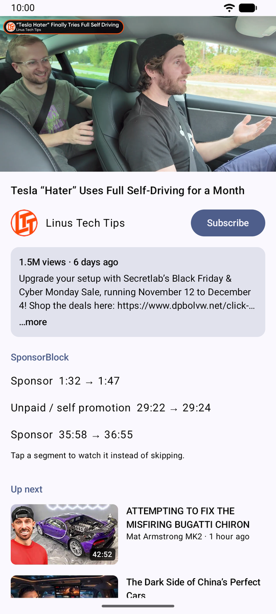
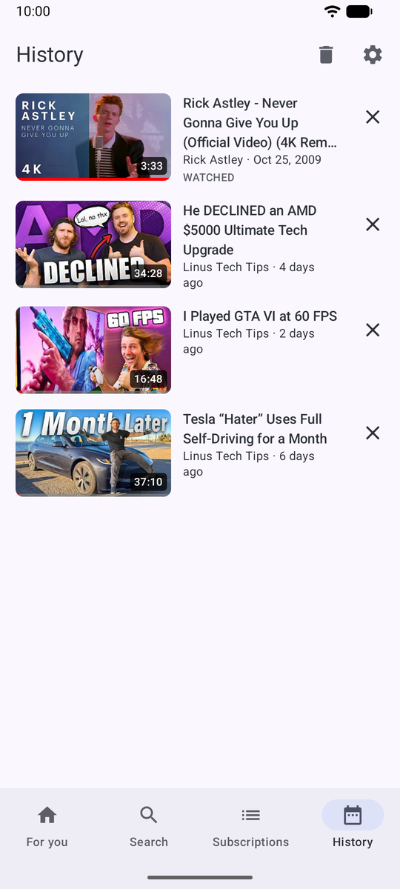

<p align="center">
  
</p>

<h1 align="center">Antenna</h1>

<p align="center">
  An Android YouTube app with no ads that skips sponsor segments for you.
</p>

<p align="center">
  <strong>No ads: YouTube's player is never loaded.</strong><br>
  <strong>Sponsors skipped automatically, with SponsorBlock.</strong><br>
  <strong>No Google account, no tracking: everything stays on your phone.</strong>
</p>

<p align="center">
  <a href="https://github.com/amreshh/antenna/actions/workflows/ci.yaml"></a>
  <a href="https://github.com/amreshh/antenna/actions/workflows/codeql.yaml"></a>
  <a href="https://github.com/amreshh/antenna/releases"></a>
  
  
  <a href="LICENSE"></a>
</p>

<p align="center">
  Phones and tablets · subscriptions without an account · watch history and resume · a For you tab
</p>

<p align="center">
  
</p>

## Contents

- [Features](#features)
- [Install](#install)
- [Build it yourself](#build-it-yourself)
- [How "For you" works](#how-for-you-works)
- [Importing your YouTube subscriptions](#importing-your-youtube-subscriptions)
- [When it stops working](#when-it-stops-working)
- [Releases](#releases)
- [Project layout](#project-layout)
- [Ideas for next steps](#ideas-for-next-steps)
- [License and legal](#license-and-legal)

## Features

### Watching

- **No ads:** videos play straight from YouTube's stream URLs (pulled out with
  [NewPipeExtractor](https://github.com/TeamNewPipe/NewPipeExtractor)) in ExoPlayer,
  so YouTube's ad-serving player is never loaded.
- **Sponsor skipping:** segment times come from [SponsorBlock](https://sponsor.ajay.app).
  The lookup uses the privacy-preserving hash-prefix endpoint, so SponsorBlock never learns
  exactly which video you're watching. Choose which categories to skip in Settings, and tap a
  segment in the list to watch it instead. The segments show on the seek bar, in green. Counting
  your skips in SponsorBlock's public stats is opt-in (Settings), because that report does name
  the video.
- **The player:** title, channel with a Subscribe button, and the description (views, date,
  tap for the full text). Timestamps in the description jump to that point, links to other
  videos open in Antenna, and other links in your browser. On phones the video goes
  fullscreen when you turn sideways. On tablets the video, with rounded corners, and its
  details sit next to Up next, and fullscreen is a button on the player, like YouTube. A video never plays the
  next one on its own, and it pauses for calls and when you unplug your headphones. While the
  controls are hidden, a thin line along the bottom of the video shows how far in you are,
  with the sponsor segments in green.
- **Mini player, like YouTube:** swipe the video down (or press Back) and it shrinks into a
  bar above the tabs (on tablets, a floating video in the bottom corner) and keeps playing
  while you search and browse. Tap it or swipe it up to bring it back; it has play/pause and
  close buttons. Leaving the app pauses it.
- **The controls, like YouTube's:** no dark bar along the bottom of the video, but the time in a
  pill on the left, and ⚙ and fullscreen in one on the right, under the seek bar. **⚙** opens
  **Quality**, where Auto plays the best quality up to the max set in Settings and shows which
  one is playing, or pick any quality the video has, for that video (it carries on from the same
  spot); and **Playback speed**, from 0.25× to 2×, which stays for the next videos.
- **Resume where you left off.**
- **Keeps playing through YouTube's hiccups:** a video server that's briefly busy (HTTP 503) or
  a dropped connection is retried for about 20 seconds; a refused or expired link (YouTube's
  expire after some hours) gets fresh ones and carries on from the same spot. If it still
  can't play, the error says why, with Try again.
- **Light on data:** on mobile data the app plays at most 480p (Settings → Max video quality on
  mobile data). Of a quality's files (AV1, VP9, H.264) it plays the smallest the phone decodes
  in hardware: YouTube says how big each is, and the newer codecs aren't always smaller. It
  buffers 15–30 seconds ahead rather than 50, so less is wasted when you leave a video early,
  and starts playing once 1 second is buffered. Back through Up next reuses the details it
  already has. The Subscriptions feed isn't loaded again within 15 minutes, and a channel whose
  feed and page both failed isn't sent to its (much bigger) page again for a day. The feed has
  no video lengths, so they're fetched from each channel's Videos tab (about 45 KB) only for
  videos on screen, once per channel, and kept with the feed.
- **Likely videos start sooner:** most of the wait when a video starts is fetching its details
  and links, so when the app opens it guesses up to 3 videos you're likely to watch (one you
  didn't finish, the newest in Watch later, the top of For you, new uploads, and the next video
  of a channel you're working through in order) and fetches their details, never any video.
  It ranks them by which channels you watch at this time of day, and keeps score: every guess is checked against what you open, kinds of guess and channels that
  keep missing go down, and it fetches fewer, or none, while its guesses aren't opened. It keeps
  guessing without fetching, and starts again once they'd be right. Analytics shows how it's
  doing (Ready before you tapped), and Settings turns it off.
- **Watch later:** save any video from its ⋮ menu, or with Watch later under the one you're
  watching. The Watch later tab lists them, newest first; Remove watched clears the ones
  you've finished.
- Share a YouTube link to Antenna, or open youtube.com / youtu.be video links with it, to play it.
- **Nothing leaves the phone:** history and subscriptions aren't included in Google Drive
  backups (moving to a new phone with Android's device-to-device transfer still brings them).

### Finding videos

- **Search** (the magnifier at the top) with suggestions as you type and infinite scroll. Tap a
  result's channel avatar to open the channel: its subscriber count, a Subscribe button and
  all its videos.
- **Subscriptions with no account:** tap Subscribe on any video. The Subscriptions tab shows the
  newest uploads from all your channels (pull down to refresh). It opens straight away with the
  feed as it last loaded, while the fresh one loads. Videos show their length, like everywhere
  else. Shorts are kept apart: the feed shows the
  other videos, and the Shorts chip above them shows the Shorts, in a grid of tall
  thumbnails. On tablets your channels are
  listed beside them, by newest activity, A–Z or topic; tap one to see only its videos. A blue
  dot, like YouTube's, marks a channel with an upload from the last week that wasn't there yet
  when you last opened it in that list. Import your existing YouTube
  subscriptions from Google Takeout ([below](#importing-your-youtube-subscriptions)), and export
  them as the same kind of file.
- **Subscriptions cleanup** (Subscriptions → ✏️ → ⋮ → Clean up): checks every channel, then
  lists the ones that don't exist anymore and the ones with no upload in a period you choose (3
  months to 5 years), each with its reason, before removing anything. Untick a channel to keep
  it; channels that couldn't be checked are always kept.
- **Analytics** tab: what your watch history says, worked out on the phone. Videos, watch
  time, channels and how many you finish; **watch time** in one chart, by day for the last 30
  days at first: pinch to zoom in to the hours you watch at, or out to weeks, and drag to go
  back through your history; your top channels; what SponsorBlock skipped for you (the time,
  and which kinds: sponsors, self promotion…); and how far you get into videos. **Topics**:
  what you watch about, from video titles and the uploaders' tags, and YouTube's categories
  (saved with each video you watch).
  **Tap any bar** to narrow the whole tab to its videos: a day, an hour of a day, a channel, a
  topic, a kind of skipped segment… Picks in different cards combine. The bar at the top lists them
  (with Open channel, or Search for a topic); × or Back takes one off. **Ready before you
  tapped**: how many of the videos you opened the app had ready, how often each kind of guess
  was opened, and what it fetches now.
  More cards: **Subscriptions** (watch time from channels you subscribe to and from the rest;
  channels you watch a lot without subscribing, with Subscribe; subscriptions you haven't
  watched in 3 months, with Unsubscribe), **Video length** (and how many of each you finish),
  **Where you open videos** (For you, Subscriptions, Up next, search…), **How new** videos
  were when you first watched them, and **Sittings** (how often you sit down to watch, for how
  long, what you actually played, days in a row, and videos you played part of again). The
  top tiles compare the last 7 days with the 7 before. Length, where from, how new and
  subscribed or not are picks too.
- **The watch log:** besides the history (how far into each video you got, and when you last
  watched it), the app records each stretch of watching: which part of the video played, when,
  and where you opened it from. A pause, a seek, a SponsorBlock skip or another video ends a
  stretch. It's what Sittings and Where you open videos come from, so they count from when it
  started being recorded. It stays on the phone (a file in the app's storage, out of cloud
  backups, kept 400 days); removing a video from the history, or clearing it, removes its
  stretches too.
- **Up next** under every video (Back returns to the previous one), and a **For you** home tab
  built from YouTube's suggestions for what you've watched ([below](#how-for-you-works)). The
  logo at the top goes back to it.
- **History, like YouTube:** a red progress bar under every thumbnail you've started, "WATCHED"
  near the end, and a History tab. Watched videos can be hidden from the Subscriptions feed.
- **Tablets and foldables:** the lists become a grid of large thumbnails, with more columns
  the wider the window, and the tabs along the bottom sit together in the middle. Tapping the
  tab you're on again takes its list back to the top, on any screen.

| | | |
|---|---|---|
|  |  |  |


## Install

Download the APK from the [latest release](https://github.com/amreshh/antenna/releases/latest)
and open it on your phone. You'll need to allow "Install unknown apps" for the app you open it
with (your browser or file manager). New releases install as updates over the old one.

Each release also has the APK's SHA-256, to check the download: `sha256sum -c antenna-v*.apk.sha256`.

## Build it yourself

1. Install [Android Studio](https://developer.android.com/studio) (current stable version).
2. **File → Open** and pick this folder. Any Gradle JDK from 17 to 25 works, including the one
   that comes with Android Studio. Wait for the Gradle sync to finish (it downloads Gradle, the
   Android SDK pieces and the libraries).
3. On your phone, turn on **Developer options → USB debugging**, plug it in, and press **Run ▶**.
   No phone? Pick an emulator in the device list (Tools → Device Manager makes one).

From the command line: `./gradlew assembleDebug` (needs `ANDROID_HOME` set, or a
`local.properties` file with `sdk.dir=...`). The APK ends up in `app/build/outputs/apk/debug/`.

Your own builds are signed with Android Studio's debug key, and the releases with the release
key. Android won't install one over the other, so uninstall first when you switch.

## How "For you" works

YouTube's personalized home feed is tied to a signed-in Google account, and NewPipeExtractor
doesn't support signing in. Signing in would also defeat the privacy point and could get the
account flagged. So Antenna builds its own version from YouTube's recommendations:

1. Each time you open a video, YouTube's "Up next" list for it is saved with your history.
2. The For you tab combines those lists from your last ~30 videos. A video gets ranked higher when:
   it's suggested after several things you watched, it comes from recent or fully watched videos,
   YouTube put it near the top of its list, or it's from a channel you subscribe to.
   Videos you've already watched are left out, and no channel gets more than 3 spots near the top.
3. Pull down to reshuffle a little.

Everything runs on the phone with no extra network requests. To tune it, change the weights in `Recommender.kt`.

## Importing your YouTube subscriptions

1. Go to [takeout.google.com](https://takeout.google.com) and click **Deselect all**.
2. Tick **YouTube and YouTube Music**. Under **All YouTube data included**, keep only **subscriptions**.
3. Export, download the zip, and unzip it. Inside is `YouTube and YouTube Music/subscriptions/subscriptions.csv`.
4. Put that file on your phone. In Antenna, go to **Subscriptions → ✏️ → Import** and choose it.

Takeout's file has no channel pictures, so Antenna fetches each imported channel's once, a few
at a time, after the feed has loaded. **⋮ → Export as CSV** on the same screen saves your
subscriptions in Takeout's format, for importing elsewhere (or back here).

The Topic order guesses what each channel is about, from what's already on the phone:
YouTube's category of the videos you watched from it, its name, and its recent titles.

## When it stops working

YouTube changes its internals often, and third-party clients break when it does. Usually:

1. **Search or "could not get stream" errors** → bump the `NewPipeExtractor` version in
   `app/build.gradle.kts` to the latest
   [release](https://github.com/TeamNewPipe/NewPipeExtractor/releases) and rebuild.
2. **Playback fails with HTTP 403** → YouTube changed how stream bytes have to be requested.
   Compare `player/YoutubeDataSource.kt` with NewPipe's
   [YoutubeHttpDataSource](https://github.com/TeamNewPipe/NewPipe/blob/dev/app/src/main/java/org/schabi/newpipe/player/datasource/YoutubeHttpDataSource.java)
   and port over whatever changed.
3. **ReCaptchaException** → YouTube is rate-limiting your IP. Wait, or switch networks.

## Releases

Like [wirepulse](https://github.com/amreshh/wirepulse), a pull request builds and checks
everything, and merging it releases exactly what it built and tested
(`.github/workflows/ci.yaml`):

- **Pull requests** run these side by side:
  - **Unit tests** (`app/src/test`): For you's recommendations, the Analytics numbers and
    picks, the watch time chart's bars, scale, labels and zooming, guessing which videos to
    get ready and keeping score, links and the Takeout import, the Subscriptions feed's blue
    dots and video lengths, counts, durations, speeds and error messages, which stream plays,
    the seek bar's segment markers, and timing tests that build For you and Analytics from a
    full history.
  - **Code coverage** of those tests (JaCoCo, `./gradlew createDebugUnitTestCoverageReport`
    locally): how much of the app's code they run, in all and by package, whether that went
    up or down from the base branch (whose code is measured too), and how much of what the
    pull request adds or changes they run, with the files where they don't
    (`.github/scripts/coverage-summary.py`). The whole report, down to each line, is the
    run's `coverage-report` artifact.
  - **Android lint**, and the **workflow checks** (actionlint, zizmor).
  - **Dependency vulnerabilities**: every library in the release APK, at the version
    Gradle resolves, checked against [osv.dev](https://osv.dev)
    (`.github/scripts/osv-deps.py`). A known vulnerability fails it, unless
    `.github/osv-ignore.txt` says why it doesn't apply. It also runs on `main` every week
    (`dependency-scan.yaml`), since advisories appear for libraries nobody changed.
  - **The release APK**: shrunk with R8, with the version merging would release, then
    checked (`.github/scripts/apk-security.py`). It must not be debuggable, must use HTTPS
    only and stay out of cloud backups, may only export the main screen and request the
    expected permissions, must be signed with scheme v2 or newer, and must stay under 8 MB.
  - **The smoke test** (`.github/scripts/smoke-test.sh`): that APK on an Android
    emulator. It has to install, start, show the home screen, load a video in the player,
    minimize it, find videos with search and open a result's channel, without crashing. It
    also measures cold start (median of 5, budget 4 s) and memory with a video loaded
    (budget 400 MB), and reports how long the video took to start playing (fetching its
    details and links, then buffering; no budget, as that depends on YouTube's servers).

  One comment on the pull request sums it all up and is updated on every run: each check's
  result and its table, the version merging releases, and a link to download the APK.
- **Merging into `main`** releases that APK: no checks run again and nothing is rebuilt. It
  gets signed with the release key (the only thing that changes), tagged `vX.Y.Z`, and
  published as a GitHub Release with its SHA-256 and release notes that group the commits by
  area (`.github/labeler.yaml`) above GitHub's generated list of pull requests. `main` only
  builds (and smoke-tests) an APK itself when there's no tested one to take: a pull request
  from a fork, one that wasn't up to date with `main`, or one whose run failed or whose APK
  expired (after 30 days, the most the repository's settings keep artifacts).
- **Version:** each release bumps the patch. Put `#minor` or `#major` in the pull request's
  title or in a commit message to bump that instead; the pull request comment shows which
  version merging releases. The first release is the `versionName` in
  `app/build.gradle.kts`. Changes to only Markdown files and `docs/` release nothing.
- **Updates install over each other:** the APK's versionCode is derived from the version,
  and every release is signed with the same key.
- **Security:** CodeQL scans the Kotlin code and the workflows (`codeql.yaml`), and
  Dependabot proposes dependency and action updates weekly (`.github/dependabot.yaml`).
  The signing key is only used by a job that builds nothing (it signs the tested APK with
  `apksigner`), and only runs on `main` and tags.
- **Small and fast:** release builds are shrunk with R8 (about 3 MB instead of 15 MB, and
  Compose runs faster). `app/proguard-rules.pro` keeps NewPipeExtractor and its JavaScript
  engine whole; if the smoke test fails where a debug build works, look there first.

### One-time setup

1. **Make the release key** (keep the file and passwords somewhere safe: if you lose
   them, installed copies can't be updated, only uninstalled and reinstalled):

   ```sh
   keytool -genkeypair -keystore antenna-release.keystore -alias antenna \
     -keyalg RSA -keysize 4096 -validity 10000 -dname "CN=Antenna"
   base64 -w0 antenna-release.keystore    # the value for ANDROID_KEYSTORE_BASE64
   ```

   `keytool` comes with any JDK, including Android Studio's (`<Android Studio>/jbr/bin`).
   `*.keystore` is in `.gitignore`. Never commit it.
2. **Add the secrets** to a `release` environment, so only release builds can read them:
   Settings → Environments → **New environment** `release`. Under *Deployment branches and
   tags*, choose *Selected branches and tags* and add the branch `main` and the tag pattern
   `v*`. Then add the environment secrets `ANDROID_KEYSTORE_BASE64`,
   `ANDROID_KEYSTORE_PASSWORD`, `ANDROID_KEY_ALIAS` (`antenna`) and `ANDROID_KEY_PASSWORD`
   (the same as the keystore's password unless you chose another). Repository secrets with
   these names work too, but any workflow run on any branch can read those.
3. **Settings → Actions → General → Workflow permissions:** keep "Read repository
   contents" (each job asks for what it needs).
4. **Settings → Advanced Security:** turn on Dependabot alerts and security updates, and
   leave CodeQL's *default* setup off (the workflow is the advanced setup).
5. **A branch rule on `main`** (Settings → Rules → Rulesets, or Branches): require a pull
   request, require the status checks `checks`, `Analyze (java-kotlin)` and `Analyze (actions)`
   (CodeQL: the code, and the workflows), and require branches to be up to date before
   merging. Then nothing unchecked can be merged, and every merge releases exactly the APK
   its pull request tested.
6. **After merging `dev` into `main`** with a squash merge, reset `dev` to `main`
   (`git switch dev && git reset --hard origin/main && git push --force-with-lease`), so the
   next pull request only shows new changes.

## Project layout

```
app/src/main/java/com/antenna/
├── App.kt                        sets up the shared OkHttp client + NewPipe.init
├── net/OkHttpDownloader.kt       HTTP layer used by NewPipeExtractor
├── data/YouTubeRepository.kt     search, pagination, stream info
├── data/Prefs.kt                 settings (skip categories, max quality)
├── data/Subscriptions.kt         local subscription store + Takeout CSV import
├── data/FeedRepository.kt        builds the feed (channel RSS, falls back to the Videos tab)
├── data/NewUploads.kt            which uploads you've seen: the channel list's blue dots
├── data/WatchHistory.kt          watch progress + saved "up next" lists (local JSON file)
├── data/Recommender.kt           ranks the For you tab from your history
├── player/StreamPicker.kt        picks the best video-only + audio stream and merges them
├── player/YoutubeDataSource.kt   fetches stream bytes the way YouTube expects (POST, rn, range, chunks)
├── player/SeekBarSegments.kt     draws the SponsorBlock segments on the seek bar
├── data/WatchStats.kt            the Analytics numbers, and narrowing them to what's picked
├── data/Guesses.kt               guessing what you'll open next, and keeping score of the guesses
├── data/Prefetcher.kt            fetches the likeliest guesses' details when the app opens
├── data/WatchLog.kt              each stretch of watching (the watch log), and sittings from it
├── sponsorblock/SponsorBlockClient.kt   segment lookup + skip reporting
└── ui/                           Compose screens: search, subscriptions feed, channel list,
                                  settings, VideoLayouts.kt (phone rows / tablet grid), and
                                  the player: PlayerViewModel.kt (playback, skip loop,
                                  Subscribe), PlayerScreen.kt (the screen, drawn over the tabs,
                                  and its ⚙ menu), MiniPlayer.kt (swiping it down into the mini
                                  player), and WatchTimeChart.kt (Analytics' zoomable chart)
app/src/main/res/layout/exo_player_control_view.xml   the video's controls (Media3's layout,
                                  changed: the time and buttons in pills), sizes in values/dimens.xml
art/logo.svg                      the logo; the launcher icon (res/drawable) is made from it
.github/                          CI, release, CodeQL, Dependabot, labeler
```

## Ideas for next steps

- Background / picture-in-picture playback (a Media3 `MediaSessionService`)
- A background refresh of the feed with new-video notifications (WorkManager)
- Subtitles (`info.subtitles` → `MediaItem.SubtitleConfiguration`)
- Targeting Android 17 (API 37) once it's checked on a real Android 17 phone (see `targetSdk` in `app/build.gradle.kts`)
- "Not interested" on For you items (save a block list of video ids / channels in `Recommender`)
- DeArrow (crowdsourced titles and thumbnails, from the same team as SponsorBlock)

## License and legal

- Antenna is free software under the [GNU General Public License v3.0 or later](LICENSE).
  It has to be: it includes NewPipeExtractor, which is GPL-3.0. Anyone who distributes the
  app, changed or not, has to publish its source under the same license.
- Playing YouTube without ads breaks YouTube's Terms of Service, so this can't be published
  on the Google Play Store. It's for personal use, sideloading, or F-Droid-style distribution.
- SponsorBlock data is CC BY-NC-SA 4.0 (non-commercial use only).
- Not affiliated with YouTube or Google.
