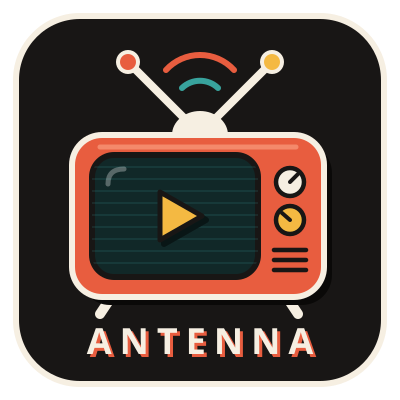
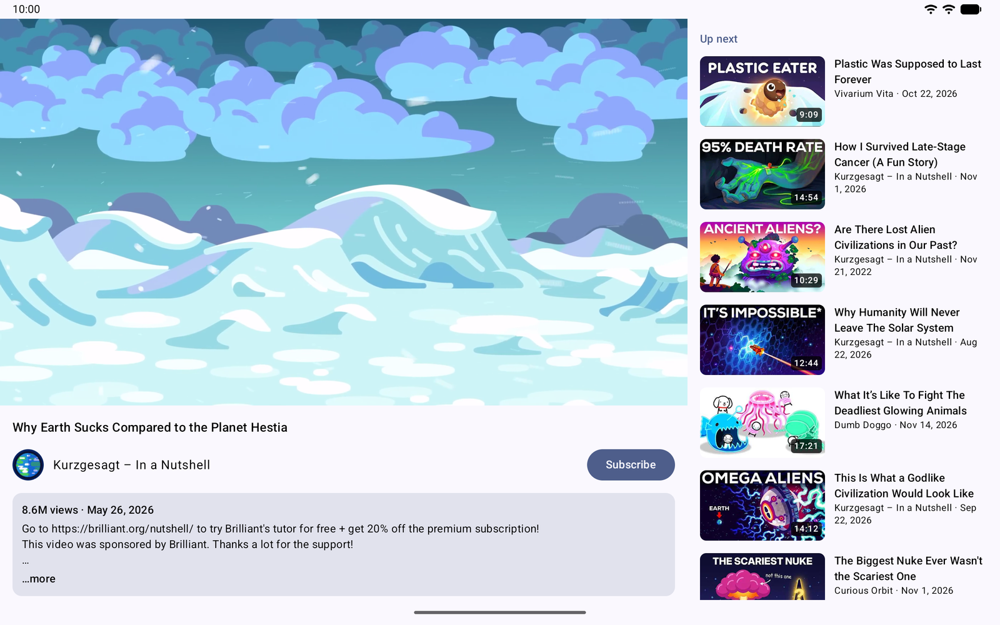
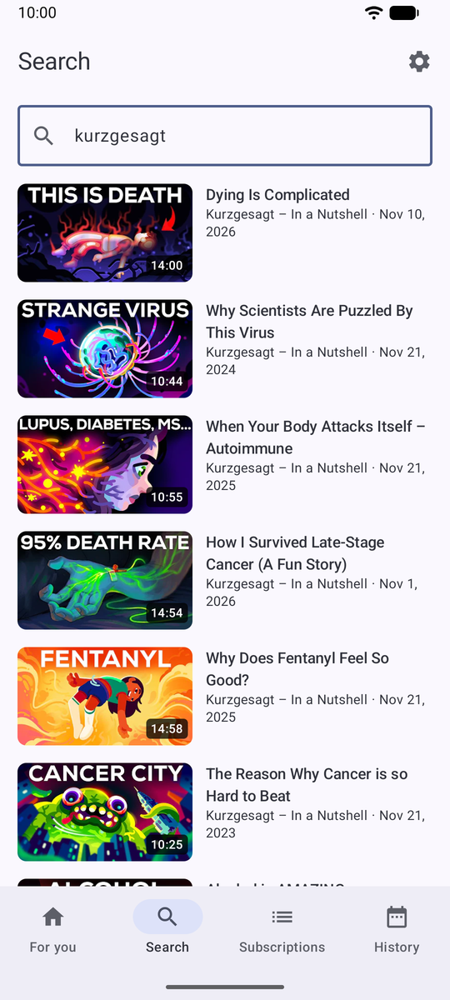
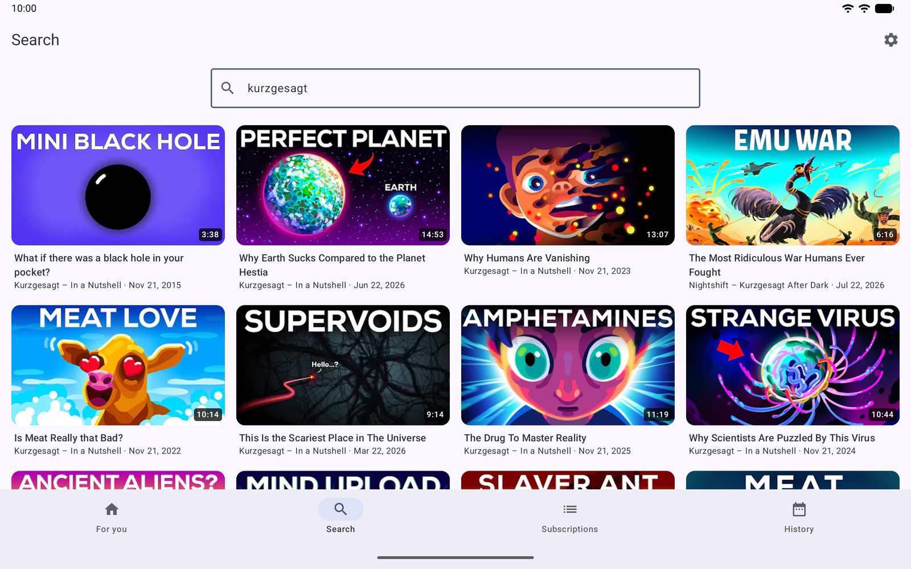

<p align="center">
  
</p>

<h1 align="center">Antenna</h1>

<p align="center">
  An Android YouTube app with no ads that skips sponsor segments for you.
</p>

<p align="center">
  <strong>No ads: YouTube's player is never loaded.</strong><br>
  <strong>Sponsors skipped automatically, with SponsorBlock.</strong><br>
  <strong>No Google account, no tracking: everything stays on your phone.</strong>
</p>

<p align="center">
  <a href="https://github.com/amreshh/antenna/actions/workflows/ci.yaml"></a>
  <a href="https://github.com/amreshh/antenna/actions/workflows/codeql.yaml"></a>
  <a href="https://github.com/amreshh/antenna/releases"></a>
  
  
  <a href="LICENSE"></a>
</p>

<p align="center">
  Phones and tablets · subscriptions without an account · watch history and resume · a For you tab
</p>

<p align="center">
  
</p>

## Contents

- [Features](#features)
- [Install](#install)
- [Build it yourself](#build-it-yourself)
- [How "For you" works](#how-for-you-works)
- [Importing your YouTube subscriptions](#importing-your-youtube-subscriptions)
- [When it stops working](#when-it-stops-working)
- [Releases](#releases)
- [Project layout](#project-layout)
- [Ideas for next steps](#ideas-for-next-steps)
- [License and legal](#license-and-legal)

## Features

### Watching

- **No ads:** videos play straight from YouTube's stream URLs (pulled out with
  [NewPipeExtractor](https://github.com/TeamNewPipe/NewPipeExtractor)) in ExoPlayer,
  so YouTube's ad-serving player is never loaded.
- **Sponsor skipping:** segment times come from [SponsorBlock](https://sponsor.ajay.app).
  The lookup uses the privacy-preserving hash-prefix endpoint, so SponsorBlock never learns
  exactly which video you're watching. Choose which categories to skip in Settings, and tap a
  segment in the list to watch it instead.
- **The player:** title, channel with a Subscribe button, and the description (views, date,
  tap for the full text with clickable links). On phones the video goes fullscreen when you
  turn sideways. On tablets the video and its details sit next to Up next, and fullscreen is
  a button on the player, like YouTube. A video never plays the next one on its own.
- **Resume where you left off**, and a max-quality setting.
- Share a YouTube link to Antenna, or open youtube.com / youtu.be links with it, to play it.

### Finding videos

- **Search** with infinite scroll.
- **Subscriptions with no account:** tap Subscribe on any video. The Subscriptions tab shows the
  newest uploads from all your channels (pull down to refresh). Import your existing YouTube
  subscriptions from Google Takeout ([below](#importing-your-youtube-subscriptions)).
- **Up next** under every video (Back returns to the previous one), and a **For you** home tab
  built from YouTube's suggestions for what you've watched ([below](#how-for-you-works)).
- **History, like YouTube:** a red progress bar under every thumbnail you've started, "WATCHED"
  near the end, and a History tab. Watched videos can be hidden from the Subscriptions feed.
- **Tablets and foldables:** the lists become a grid of large thumbnails, with more columns
  the wider the window.

| | | |
|---|---|---|
|  |  |  |



## Install

Download the APK from the [latest release](https://github.com/amreshh/antenna/releases/latest)
and open it on your phone. You'll need to allow "Install unknown apps" for the app you open it
with (your browser or file manager). New releases install as updates over the old one.

Each release also has the APK's SHA-256, to check the download: `sha256sum -c antenna-v*.apk.sha256`.

## Build it yourself

1. Install [Android Studio](https://developer.android.com/studio) (current stable version).
2. **File → Open** and pick this folder. Any Gradle JDK from 17 to 25 works, including the one
   that comes with Android Studio. Wait for the Gradle sync to finish (it downloads Gradle, the
   Android SDK pieces and the libraries).
3. On your phone, turn on **Developer options → USB debugging**, plug it in, and press **Run ▶**.
   No phone? Pick an emulator in the device list (Tools → Device Manager makes one).

From the command line: `./gradlew assembleDebug` (needs `ANDROID_HOME` set, or a
`local.properties` file with `sdk.dir=...`). The APK ends up in `app/build/outputs/apk/debug/`.

Your own builds are signed with Android Studio's debug key, and the releases with the release
key. Android won't install one over the other, so uninstall first when you switch.

## How "For you" works

YouTube's personalized home feed is tied to a signed-in Google account, and NewPipeExtractor
doesn't support signing in. Signing in would also defeat the privacy point and could get the
account flagged. So Antenna builds its own version from YouTube's recommendations:

1. Each time you open a video, YouTube's "Up next" list for it is saved with your history.
2. The For you tab combines those lists from your last ~30 videos. A video gets ranked higher when:
   it's suggested after several things you watched, it comes from recent or fully watched videos,
   YouTube put it near the top of its list, or it's from a channel you subscribe to.
   Videos you've already watched are left out, and no channel gets more than 3 spots near the top.
3. Pull down to reshuffle a little.

Everything runs on the phone with no extra network requests. To tune it, change the weights in `Recommender.kt`.

## Importing your YouTube subscriptions

1. Go to [takeout.google.com](https://takeout.google.com) and click **Deselect all**.
2. Tick **YouTube and YouTube Music**. Under **All YouTube data included**, keep only **subscriptions**.
3. Export, download the zip, and unzip it. Inside is `YouTube and YouTube Music/subscriptions/subscriptions.csv`.
4. Put that file on your phone. In Antenna, go to **Subscriptions → ✏️ → Import** and choose it.

## When it stops working

YouTube changes its internals often, and third-party clients break when it does. Usually:

1. **Search or "could not get stream" errors** → bump the `NewPipeExtractor` version in
   `app/build.gradle.kts` to the latest
   [release](https://github.com/TeamNewPipe/NewPipeExtractor/releases) and rebuild.
2. **Playback fails with HTTP 403** → YouTube changed how stream bytes have to be requested.
   Compare `player/YoutubeDataSource.kt` with NewPipe's
   [YoutubeHttpDataSource](https://github.com/TeamNewPipe/NewPipe/blob/dev/app/src/main/java/org/schabi/newpipe/player/datasource/YoutubeHttpDataSource.java)
   and port over whatever changed.
3. **ReCaptchaException** → YouTube is rate-limiting your IP. Wait, or switch networks.

## Releases

GitHub Actions (`.github/workflows/ci.yaml`) lints and tests every pull request and
attaches a debug APK to the run. Every merge to `main` makes a release: a tag `vX.Y.Z`
and a GitHub Release with the signed APK, its SHA-256, and release notes that group the
commits by area (`.github/labeler.yaml`) above GitHub's generated list of pull requests.

- **Version:** each release bumps the patch. Put `#minor` or `#major` in a commit
  message (e.g. the merge commit) to bump that instead. The first release is the
  `versionName` in `app/build.gradle.kts`. Changes to only Markdown files and `docs/` don't release.
- **Updates install over each other:** the APK's versionCode is derived from the version,
  and every release is signed with the same key.
- **Security:** CodeQL scans the Kotlin code and the workflows (`codeql.yaml`), and
  Dependabot proposes dependency and action updates weekly (`.github/dependabot.yaml`).

### One-time setup

1. **Make the release key** (keep the file and passwords somewhere safe: if you lose
   them, installed copies can't be updated, only uninstalled and reinstalled):

   ```sh
   keytool -genkeypair -keystore antenna-release.keystore -alias antenna \
     -keyalg RSA -keysize 4096 -validity 10000 -dname "CN=Antenna"
   base64 -w0 antenna-release.keystore    # the value for ANDROID_KEYSTORE_BASE64
   ```

   `keytool` comes with any JDK, including Android Studio's (`<Android Studio>/jbr/bin`).
   `*.keystore` is in `.gitignore`. Never commit it.
2. **Add the secrets** under Settings → Secrets and variables → Actions:
   `ANDROID_KEYSTORE_BASE64`, `ANDROID_KEYSTORE_PASSWORD`, `ANDROID_KEY_ALIAS` (`antenna`)
   and `ANDROID_KEY_PASSWORD` (the same as the keystore's password unless you chose another).
3. **Settings → Actions → General → Workflow permissions:** keep "Read repository
   contents" (each job asks for what it needs).
4. **Settings → Advanced Security:** turn on Dependabot alerts and security updates, and
   leave CodeQL's *default* setup off (the workflow is the advanced setup).
5. Optional: a branch rule on `main` that requires the `build` and CodeQL checks, so
   nothing unchecked gets released.

## Project layout

```
app/src/main/java/com/example/antenna/
├── App.kt                        sets up the shared OkHttp client + NewPipe.init
├── net/OkHttpDownloader.kt       HTTP layer used by NewPipeExtractor
├── data/YouTubeRepository.kt     search, pagination, stream info
├── data/Prefs.kt                 settings (skip categories, max quality)
├── data/Subscriptions.kt         local subscription store + Takeout CSV import
├── data/FeedRepository.kt        builds the feed (channel RSS, falls back to the Videos tab)
├── data/WatchHistory.kt          watch progress + saved "up next" lists (local JSON file)
├── data/Recommender.kt           ranks the For you tab from your history
├── player/StreamPicker.kt        picks the best video-only + audio stream and merges them
├── player/YoutubeDataSource.kt   fetches stream bytes the way YouTube expects (POST, rn, range, chunks)
├── sponsorblock/SponsorBlockClient.kt   segment lookup + skip reporting
└── ui/                           Compose screens: search, subscriptions feed, channel list,
                                  settings, player (+ skip loop and Subscribe button),
                                  VideoLayouts.kt (phone rows / tablet grid)
art/logo.svg                      the logo; the launcher icon (res/drawable) is made from it
.github/                          CI, release, CodeQL, Dependabot, labeler
```

## Ideas for next steps

- Background / picture-in-picture playback (a Media3 `MediaSessionService`)
- Channel pages (tap a channel → `ChannelInfo` + its Videos tab), and grouping or filtering Shorts out of the feed
- Caching the feed to disk so it opens instantly, plus a background refresh with new-video notifications (WorkManager)
- Subtitles (`info.subtitles` → `MediaItem.SubtitleConfiguration`)
- A quality picker in the player, and sponsor segments drawn on the seek bar
- "Not interested" on For you items (save a block list of video ids / channels in `Recommender`)
- DeArrow (crowdsourced titles and thumbnails, from the same team as SponsorBlock)

## License and legal

- Antenna is free software under the [GNU General Public License v3.0 or later](LICENSE).
  It has to be: it includes NewPipeExtractor, which is GPL-3.0. Anyone who distributes the
  app, changed or not, has to publish its source under the same license.
- Playing YouTube without ads breaks YouTube's Terms of Service, so this can't be published
  on the Google Play Store. It's for personal use, sideloading, or F-Droid-style distribution.
- SponsorBlock data is CC BY-NC-SA 4.0 (non-commercial use only).
- Not affiliated with YouTube or Google.
